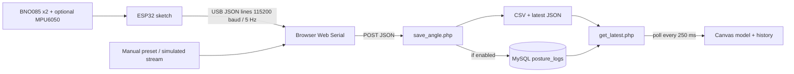

# Architecture and implementation map

This describes upstream `ad2cbc2` plus local setup and protocol-v1 fixes. Current telemetry/calibration details are in `DEVICE_PROTOCOL.md`. Research statements in the presentation/plan have not been independently validated here.

## Files and responsibilities

| File | Responsibility |
| --- | --- |
| `index.html` | Seven-slide pitch deck, Canvas 3D biomechanical simulation, presets/calibration demo, optional API polling and USB input |
| `live_test.html` | USB workbench, manual presets, 4 Hz API polling, recent history, browser CSV export and optional File System Access writes |
| `wiring_guide.html` | Self-contained interactive breadboard/wiring guide |
| `sensor_demo.html`, `assets/sensor-demo.js`, `assets/sensor-demo.css` | Read-only monitor-based Three.js scan/bust viewer, measured head angles, address markers and explicitly inferred CVA posture proxy |
| `assets/demo-posture.js`, `api/hardware_status.php` | Demo persistence timer and loopback-only sanitized monitor snapshot; no serial ownership or history writes |
| `esp32_c7_prototype/esp32_c7_prototype.ino` | Reads dual BNO08x and optional C7 MPU6050, applies auto-zero, emits JSON via USB serial |
| `api/save_angle.php` | Accepts JSON or GET/POST parameters, rounds angles, calculates missing CVA, optionally inserts MySQL, appends CSV, writes latest JSON |
| `api/get_latest.php` | Reads MySQL first, then CSV, then latest JSON, then a default baseline; returns latest record and up to 15 recent rows |
| `api/config.php` | Local INI config/environment overrides, PDO creation and data paths |
| `assets/c7-device.js` | Shared CVA geometry, protocol validation and serial session lifecycle |
| `scripts/router.php` | Local route allowlist and configured CSV/JSON downloads |
| `api/db_init.sql` | Original MySQL schema and baseline INSERT |
| `base_plan.md` | Original design and research roadmap; some sections differ from the current sketch |

## Current data flow

Both pages apply calibrated USB angles directly and reject invalid/stale readings. Firmware owns tare; browser/sessionStorage tare is removed. USB excludes DB/manual/synthetic updates. Workbench buffers export rows in `localStorage` (`c7_csv_rows`) and can write/export a separate CSV. Browser USB sequence IDs/counts differ from server history.

## API contract

`POST /api/save_angle.php` accepts `c7_angle`, `head_pitch`, `head_roll`, `head_yaw`, `cva_angle`. At least one of `c7_angle`, `head_pitch`, `cva_angle` must be present. Omitted fields default to -9/0/0/0; omitted CVA is calculated by the PHP model. It also accepts GET/form parameters for legacy clients. OPTIONS is handled for CORS.

Response fields: `status`, `id`, five angles, `created_at`, `mysql_saved`, `csv_saved`, `mysql_error`.

`GET /api/get_latest.php` returns `status`, `source`, `mysql_connected`, `csv_exists`, `total_rows`, `data` and `history`. Rows are ordered newest first. Timestamps are formatted in Asia/Bangkok. When no records exist, the baseline `data`/`history` row has ID 1 and CVA 52.05 while `total_rows` remains 0.

There are no authenticated users, WebSocket server, message broker or framework/build dependency. The original two dashboards use inline math and Canvas. Motion Studio uses vendored Three.js and a licensed head scan (see assets/vendor/README.md), with no runtime CDN. The optional local Python hardware monitor publishes ignored snapshots for the demo; its lifetime is separate from the PHP server.

## Firmware details

- Single I2C bus on GPIO21/22. BNO addresses 0x4A/0x4B; optional MPU6050 at 0x68.
- BNO report: SparkFun `enableARVRStabilizedRotationVector(50)` (20 Hz), with independent per-sensor transport state. Output JSON interval: 200 ms (5 Hz).
- Ear orientations are converted to Euler angles and combined with a wrap-aware midpoint. One sensor is accepted when the other is absent; all detected sensors must have fresh samples.
- Auto-zero captures Euler offsets after fresh readings and 1.5 s uptime. BOOT or serial `z/Z/c/C` re-tares and increments calibration_id. Protocol v1 adds boot identity, validity and sensor freshness; invalid measurements are null.
- Output is clamped: pitch -25..45, roll -30..30, yaw -40..40, C7 -15..35 degrees.
- Without MPU6050, C7 is inferred from head pitch. With it, C7 still includes a weighted head-pitch contribution.
- GPIO25 motor is initialized LOW; the current sketch does not implement timed vibration control.
- The sketch does not implement the complete quaternion SLERP/drift/coherence pipeline described in the plan. The web simulation demonstrates parts of that concept separately.

## Local setup boundary

The supplied server binds only 127.0.0.1 and exposes three pages, two endpoints and the configured CSV/JSON downloads. Source/config/docs/git metadata are not served. Without `.env`, API defaults retain the original behavior. The generated `.env` selects file mode and a separate ignored data directory.

This initialization does not refactor the original measurement model or API persistence design. Known constraints and recommended next steps are recorded in `HANDOFF.md`.
